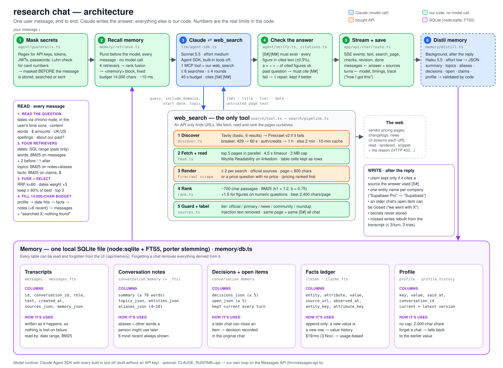

# Design

**The model writes the answer. Our code makes sure it's right.** Memory, search and verification are all code we own, and each part was built in response to a failure we measured. → Every decision with its evidence: [DECISIONS.md](DECISIONS.md) · Run it: [SETUP.md](SETUP.md)

## How it works

## Why it's built this way

### 1. Memory is read first, and doesn't need the right words

- **It can't be skipped.** Recall runs before the model on every message, not as a tool the model might forget. Any answer about the past that cites no memory record is sent back.
- **It finds vague references with no model call.** The 6 most recent chats are always in view, each saved chat gets alternative words ("db hosting", "moisturiser"), and four searches (dates, words, topics, facts) are fused. "That database thing" and "is it still $25?" find the right chat. **Measured: 11/16 → 20/20.**
- **It remembers what matters:**
  - **decisions and open items:** "which did we pick?" → "not yet: HubSpot vs Pipedrive, after Friday's demo"
  - **a facts ledger that never overwrites:** Neon *$19/mo (3 Nov) → usage-based (10 Nov)*
  - **a profile with history**
- **It's honest and it's yours.** The memory block says what was searched, including "nothing on 5 Nov", so the agent never invents a conversation. Everything sits in one local SQLite file, and any item can be viewed and forgotten.

### 2. Search reads the pages, not the snippets

- **The problem:** a search API returns ~500-character snippets. Pipedrive's missed its pricing table, and the model quoted prices that weren't in its source.
- **Why not their full-page option:** their extractor would decide what we read, we couldn't rank it against the question, and it costs more credits.
- **So we buy only step 1:**

| Step | Who | What happens | Why |
|---|---|---|---|
| Find URLs | Tavily → Firecrawl | 6 results; circuit breaker skips a failing provider; 10-min cache | Nobody can crawl the web; two providers, no single point of failure |
| Download | ours | Top 5 pages in parallel, 4.5 s timeout | We need the exact text we cite, to check figures and show the passage |
| Extract | ours | Readability; table cells kept as rows | Pages are mostly menus, and pricing grids aren't article-shaped |
| Render JS | Firecrawl, ≤ 2 | Only pages with < 800 chars, or no price on a price question; `/pricing` first | HubSpot's prices load only via JavaScript; each render costs a credit |
| Pick passages | ours | BM25 against the question, figures boosted, ~2,400 chars/page | A page is too long for the model; the price table must beat the intro |
| Label | ours | `[S#]`, reliability tier, date; injected instructions removed | The model knows what to trust and cites IDs, not URLs |

- **The snippet is only the fallback.** If a page can't be read, the snippet is used and labelled "snippet only", with the reason.

### 3. Every claim is checked in code, and you can check it too

- **Citations are IDs (`[S3]`, `[M1]`), never URLs.**
- **Every figure must appear in the text it cites.** Arithmetic on cited figures is allowed. A failed check gets one repair pass.
- **One click to verify:** a citation shows the exact passage read, with the figure highlighted.

### 4. The model: Claude, locked down to the brief

- **Claude Sonnet 5.5 through the Claude Agent SDK, because we had no API key** (the SDK runs on a Claude Code login). Every built-in tool is off; `web_search` is its only tool, and our database is its only memory.
- **With a key,** `CLAUDE_RUNTIME=api` swaps in our own ~100-line loop on the Messages API. It was tested against a local fake of the API, not yet the live one.

## Measured and rejected

- **Memory:** 20/20 recall and 8/8 write checks, three runs in a row. **End to end:** 13/14 with the real model and web; the miss was the test's wording. **Speed:** 167 s → 17 s and 46.5 s → 5.5 s, fixed from per-step timings.
- **Rejected:**
  - a `recall_memory` tool: the model could skip it
  - embeddings: they picked the wrong chat
  - a routing model call per question: the 20/20 needed none
  - a judge model per answer: code checks are free
  - Gemini: overloaded and out of quota

## With another week

- **Run our own API loop live** and make it the default for key holders.
- **Faster first words** on search answers: stream an opening line while pages load.
- **Watch tracked facts:** re-check stored prices on a schedule and flag changes.
- **Public benchmarks:** test on LongMemEval and FreshQA samples, plus a claim-by-claim citation judge.
