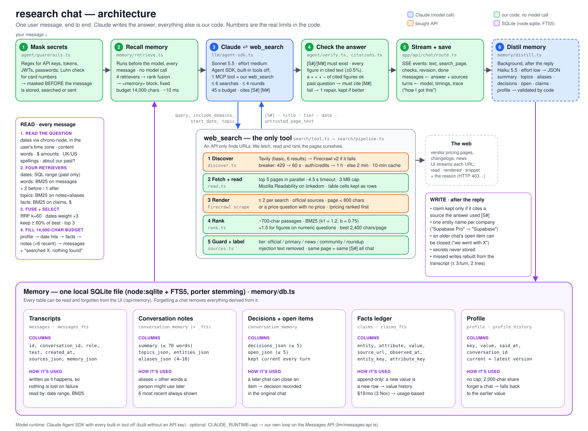

# research chat

A chat agent with one tool, web search. It remembers your past conversations and cites every claim.

| Read | For |
|---|---|
| **[SETUP.md](SETUP.md)** | Running it, step by step |
| **[DESIGN.md](DESIGN.md)** | How it works and why it's built this way |
| **[DECISIONS.md](DECISIONS.md)** | Every decision: what we chose, what it beat, and the evidence |



## What it does

- **Searches the web its own way.** A search API only finds the URLs; the agent reads and ranks the pages itself. You can watch every URL it opens.
- **Remembers.** Past questions, what you decided, what's still open, and how prices changed over time, all in one local file you can inspect and edit.
- **Proves its claims.** Every claim is cited. Hovering a citation shows the exact passage the agent read; clicking it opens the page at that passage.
- **Shows its work.** "How I got this" under each answer lists the memory used, every search and every check.

Try:
- *"Compare HubSpot, Pipedrive and Salesforce pricing for a 20-person sales team"*
- *"What did I ask you on 3 November? Is your answer still correct today?"*
- *"Last Tuesday I asked you about Postgres hosting. Has any pricing changed since?"*

## Quick start

```bash
npm install
cp .env.example .env.local   # add TAVILY_API_KEY or FIRECRAWL_API_KEY
npm run dev                  # http://localhost:3000
```

It uses the Claude Code login on the machine, or `ANTHROPIC_API_KEY`. Details: [SETUP.md](SETUP.md).

## Code map

```
src/lib/agent/run.ts         one user turn, start to finish
src/lib/agent/verify.ts      checks on the answer: memory grounding, freshness, links, citation repair
src/lib/agent/citations.ts   figure-by-figure citation check
src/lib/agent/guardrails.ts  secrets, privacy, injection, links, rate limit
src/lib/agent/prompt.ts      system prompt
src/lib/llm/                 the model: agent-sdk.ts (primary) · messages-api.ts (own loop, optional)
src/lib/search/              web_search: tool.ts → pipeline.ts (discover → read → rank) · source tiers
src/lib/memory/              db.ts (storage) · query.ts (dates, words) · retrieve.ts (recall) · distill.ts (writing notes)
src/lib/evidence.ts          finds the passage that backs each citation
src/components/              chat UI: answer, search log, memory drawer
scripts/                     eval.ts (end-to-end tests) · memory-probe.ts (memory tests)
```
